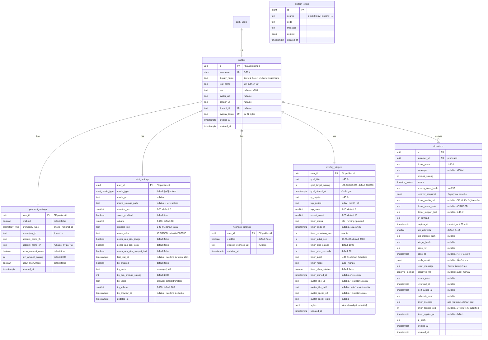

# KORTANGNOI — ER Diagram

Database: Supabase Postgres · เงินเป็นสตางค์ (`int`) · เวลาเป็น `timestamptz`



## Enum

| Enum               | ค่า                                                                                |
| ------------------ | --------------------------------------------------------------------------------- |
| `donation_status`  | `awaiting_slip`, `verifying`, `approved`, `pending_review`, `rejected`, `expired` |
| `promptpay_type`   | `phone`, `national_id`                                                            |
| `alert_media_type` | `default`, `gif`, `upload`                                                        |
| `approval_method`  | `auto`, `manual`                                                                  |

## Constraint สำคัญ

- `profiles.username`: `citext` + unique + `CHECK (username ~ '^[a-z0-9_-]{3,20}$')` — unique index ตัดสินกรณีจองพร้อมกัน
- `donations.amount_satang`: `CHECK (amount_satang > 0 AND amount_satang <= 10000000)`
- `donations.slip_attempts`: `CHECK (slip_attempts BETWEEN 0 AND 3)`
- `payment_settings.min_amount_satang`: `CHECK (BETWEEN 100 AND 1000000)`
- `payment_settings`: `promptpay_id` ยาว 0 / 10 / 13 หลัก, ชื่อยาว ≤ 100, `enabled` ⇒ `promptpay_id` และ `account_name_th` ไม่ว่าง (สำรอง validation ใน API)
- `alert_settings`: `CHECK (duration_sec BETWEEN 3 AND 20)`, `CHECK (volume BETWEEN 0 AND 100)`, `support_text` ยาว 1–40, `name_color ~ '^#[0-9A-F]{6}$'`, `media_type = 'upload'` ⇒ มี `media_url` และ `media_storage_path`
- **กันสลิปซ้ำ** — partial unique index นับเฉพาะรายการที่ "ใช้สลิปไปแล้ว":
  ```sql
  CREATE UNIQUE INDEX donations_trans_ref_used
    ON donations (trans_ref) WHERE status IN ('approved', 'pending_review');
  CREATE UNIQUE INDEX donations_slip_qr_hash_used
    ON donations (slip_qr_hash) WHERE status IN ('approved', 'pending_review');
  ```
  เหตุผล: ถ้าคนร้ายเอาสลิปของคนอื่นมาส่งในหน้าสตรีมเมอร์ผิดคนแล้วถูก `rejected` สลิปนั้นต้องยังใช้กับเจ้าของจริงได้
- แถว `payment_settings`, `alert_settings`, `webhook_settings` สร้างพร้อม `profiles` (ค่าเริ่มต้น) ด้วย trigger ตอนสร้าง profile; `overlay_widgets` (F14) สร้างด้วย trigger `after insert` บน `profiles`

## Index

| Index                                                                                      | ใช้กับ                                        |
| ------------------------------------------------------------------------------------------ | ------------------------------------------- |
| `donations (streamer_id, status, created_at DESC)`                                         | ประวัติ + ตัวกรองสถานะ (F5), นับรอตรวจ          |
| `donations (streamer_id, created_at) WHERE status = 'approved'`                            | ยอดรวมวันนี้/เดือนนี้                             |
| `donations (streamer_id, created_at) WHERE status = 'approved' AND alert_acked_at IS NULL` | overlay ดึงรายการที่พลาด (F4)                  |
| `donations (ip_hash, created_at)`                                                          | rate limit สร้างรายการ (F8) ต่อ IP + สตรีมเมอร์ |
| `system_errors (created_at DESC)`                                                          | หน้าแอดมิน (F12)                              |

## Row Level Security

เปิด RLS ทุกตาราง ค่าเริ่มต้นคือปฏิเสธทั้งหมด

| ตาราง              | anon | เจ้าของ (authenticated)                 | server (secret key) |
| ------------------ | ---- | -------------------------------------- | ------------------- |
| `profiles`         | –    | select แถวตัวเอง (แก้ผ่าน API เท่านั้น)      | ทั้งหมด               |
| `payment_settings` | –    | select แถวตัวเอง (แก้ผ่าน API เท่านั้น)      | ทั้งหมด               |
| `alert_settings`   | –    | select แถวตัวเอง (แก้ผ่าน API เท่านั้น)      | ทั้งหมด               |
| `webhook_settings` | –    | select / update แถวตัวเอง               | ทั้งหมด               |
| `overlay_widgets`  | –    | select แถวตัวเอง (แก้ผ่าน API เท่านั้น)      | ทั้งหมด               |
| `donations`        | –    | select แถวที่ `streamer_id = auth.uid()` | ทั้งหมด               |
| `system_errors`    | –    | –                                      | ทั้งหมด               |

- หน้าโดเนท, overlay และการตรวจสลิปไม่ให้ client อ่าน DB ตรง ทุกอย่างผ่าน API ของเราที่ใช้ service role
- `select` ของเจ้าของบน `donations` ทำให้ dashboard ใช้ Realtime `postgres_changes` แจ้งรายการรอตรวจใหม่ได้
- `realtime.messages`: `anon`, `authenticated` **select** (รับ) broadcast ของ topic `overlay:%` ได้อย่างเดียว ไม่มี policy insert → client ส่ง alert ปลอมเข้า overlay ไม่ได้

## Storage

| Bucket          | Public       | Path                                                                            | สิทธิ์                                                           |
| --------------- | ------------ | ------------------------------------------------------------------------------- | ------------------------------------------------------------- |
| `profile-media` | อ่านได้สาธารณะ | `{user_id}/{avatar\|banner}-{uuid}.{ext}`                                       | server เท่านั้น (ผ่าน API), ≤ 4 MB                                |
| `alert-media`   | อ่านได้สาธารณะ | `{user_id}/{uuid}.{ext}`, avatar: `{user_id}/avatar-{idle\|speak}-{uuid}.{ext}` | server เท่านั้น (ผ่าน API), ≤ 4 MB                                |
| `tts-audio`     | private      | `{user_id}/{uuid}.mp3`                                                          | server เท่านั้น, overlay ได้ signed URL 10 นาที, ลบไฟล์เก่ากว่า 1 ชม. |
| `slips`         | private      | `{streamer_id}/{donation_id}/{attempt}.{ext}`                                   | server เท่านั้น, เจ้าของดูผ่าน signed URL 10 นาที                    |
