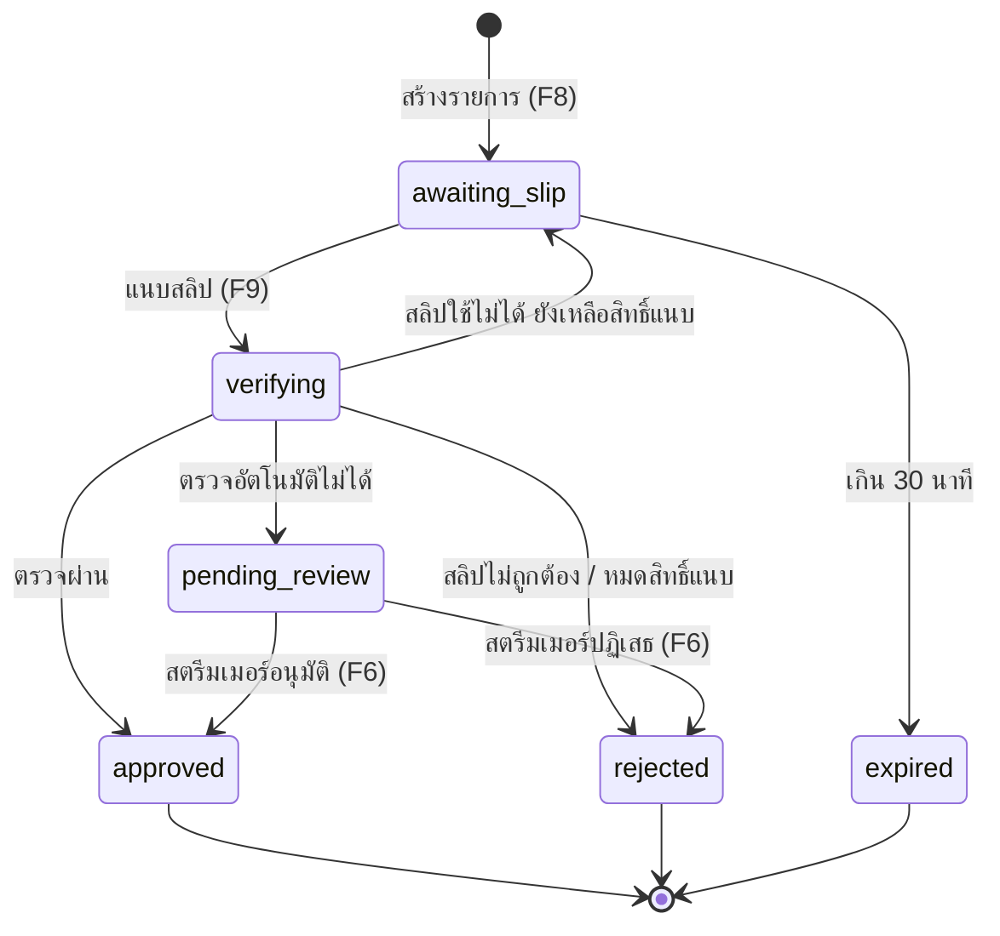

# KORTANGNOI — Spec

อ้างอิง feature จาก `docs/requirements.md` (F1–F12) · stack ตาม `docs/design-brief.md`

## ข้อตกลงรวม

### API

- ทุก endpoint เป็น Next.js Route Handler ใต้ `/api` รับ-ส่ง JSON (ยกเว้นอัปโหลดไฟล์ใช้ `multipart/form-data`)
- Route handler ทำแค่ auth + validate + เรียก service ใน `src/server/services/` (เพื่อให้ Discord bot ใช้ซ้ำได้)
- Validate ทุก input ด้วย Zod ที่ boundary
- Endpoint ที่ต้องล็อกอิน: ใช้ session ของ Supabase Auth (cookie) ไม่มี session → `401`
- รูปแบบ error เดียวทั้งระบบ:
  ```json
  { "error": { "code": "AMOUNT_TOO_LOW", "message": "ยอดต้องไม่ต่ำกว่า 20 บาท" } }
  ```
  `message` เป็นภาษาไทยที่แสดงให้ผู้ใช้ได้เลย, `code` ใช้ในโค้ดและ test

| HTTP | ใช้เมื่อ                                    |
| ---- | ---------------------------------------- |
| 400  | input ไม่ผ่าน validation                   |
| 401  | ไม่ได้ล็อกอิน                                |
| 403  | ล็อกอินแล้วแต่ไม่มีสิทธิ์                         |
| 404  | ไม่พบ                                     |
| 409  | ชนกับข้อมูลที่มีอยู่ (username ซ้ำ, สถานะไม่ถูกต้อง) |
| 429  | เกิน rate limit                           |
| 500  | error ภายใน (log ไว้ ไม่ส่งรายละเอียดออกไป)  |

### เงิน

- เก็บเป็น **สตางค์ (integer)** ทุกที่ (`amount_satang`) แปลงเป็นบาทตอนแสดงผลเท่านั้น
- ผู้บริจาคกรอกได้ทศนิยมไม่เกิน 2 ตำแหน่ง
- ยอดสูงสุดต่อรายการ 100,000 บาท

### เวลา

- เก็บเป็น `timestamptz` (UTC) แสดงผลเป็นเวลาไทย (Asia/Bangkok)

### สถานะโดเนท



| สถานะ            | ความหมาย                  | ผู้บริจาคเห็น            |
| ---------------- | ------------------------- | -------------------- |
| `awaiting_slip`  | สร้าง QR แล้ว รอสลิป         | QR + ปุ่มแนบสลิป        |
| `verifying`      | กำลังตรวจ (ชั่วคราว ไม่กี่วินาที) | กำลังตรวจสอบ...       |
| `approved`       | ผ่าน ขึ้น alert แล้ว          | ✅ ขอบคุณ             |
| `pending_review` | รอสตรีมเมอร์ตรวจ            | ⏳ รอสตรีมเมอร์ตรวจสอบ |
| `rejected`       | ไม่ผ่าน                     | ❌ + เหตุผล           |
| `expired`        | ไม่แนบสลิปใน 30 นาที         | หมดเวลา สร้างใหม่      |

การเปลี่ยนสถานะทุกครั้งต้องเป็น **conditional update** (`UPDATE ... WHERE status = <สถานะเดิม>`) กันสองคำขอทำพร้อมกัน

---

## F1 ล็อกอิน + ตั้ง username

### หน้าจอ

- `/login` — ปุ่ม "เข้าสู่ระบบด้วย Google" และ "เข้าสู่ระบบด้วย Discord"
- `/onboarding` — ตั้ง username ครั้งแรก (แสดงตัวอย่างลิงก์ `kortangnoi.../{username}` แบบ live) แล้วไปหน้าตั้งค่าช่องทางรับเงิน
- ทุกหน้าใต้ `/dashboard` ต้องล็อกอิน; ยังไม่มี username → redirect ไป `/onboarding`; ล็อกอินอยู่แล้วเปิด `/login` → `/dashboard`
- **dev/test เท่านั้น:** `/login` มีฟอร์มอีเมล/รหัสผ่านเพิ่ม เมื่อ `NEXT_PUBLIC_ENABLE_PASSWORD_LOGIN=true` (ใช้กับ Supabase ในเครื่องและ Playwright เพราะ OAuth จริงทดสอบอัตโนมัติไม่ได้) — บน production ปิด flag และปิด email provider ใน Supabase

### Flow

1. กดปุ่ม → Supabase OAuth → callback `/auth/callback`
2. ครั้งแรก: สร้างแถว `profiles` (id = auth user id, เก็บ `discord_id` ถ้าล็อกอินด้วย Discord) → `/onboarding`
3. ครั้งถัดไป: → `/dashboard`

### API

| Method | Path                      | Request        | Response                                            |
| ------ | ------------------------- | -------------- | --------------------------------------------------- |
| GET    | `/api/me`                 | –              | `{ id, username, displayName, discordId, isAdmin }` |
| GET    | `/api/usernames/check?u=` | –              | `{ available: boolean }`                            |
| PUT    | `/api/me/username`        | `{ username }` | `{ username }`                                      |

### Validation

- username: 3–20 ตัว, `^[a-z0-9_-]+$`, แปลงเป็นตัวเล็กก่อนเช็ก
- ห้ามคำสงวน: `api, auth, login, logout, onboarding, dashboard, overlay, admin, settings, static, _next, d`
- เปลี่ยน username ได้ (ลิงก์เก่าใช้ไม่ได้ทันที — แจ้งเตือนก่อนบันทึก)

### Error case

| กรณี                  | ผล                                                    |
| -------------------- | ----------------------------------------------------- |
| username ซ้ำ          | 409 `USERNAME_TAKEN`                                  |
| ผิดรูปแบบ / คำสงวน     | 400 `USERNAME_INVALID`                                |
| OAuth ยกเลิกหรือล้มเหลว | กลับ `/login` พร้อมข้อความ "เข้าสู่ระบบไม่สำเร็จ ลองใหม่อีกครั้ง" |

### พังได้ยังไง

- สองคนจอง username เดียวกันพร้อมกัน → ใช้ unique index ใน DB เป็นตัวตัดสิน ไม่ใช่แค่ check ก่อน insert
- คนเดิมล็อกอินด้วย Google แล้วรอบหลังใช้ Discord → ได้คนละบัญชี (MVP ยอมรับ; แสดงข้อความแนะนำให้ใช้ช่องทางเดิม)
- redirect URL ของ OAuth ตั้งผิดบน Vercel preview → ล็อกอินไม่ได้บน preview (ตั้ง wildcard redirect ใน Supabase)

---

## F2 ตั้งค่าช่องทางรับเงิน

### หน้าจอ `/dashboard/payment`

การ์ดแบบเดียวกับ reference:

- **ยอดขั้นต่ำ** (บาท, ปุ่ม − / +)
- **พร้อมเพย์:** สวิตช์เปิด/ปิดรับโดเนท, ประเภท (เบอร์โทร / เลขบัตรประชาชน), เลข PromptPay, ชื่อบัญชีไทย, ชื่อบัญชีอังกฤษ (ไม่บังคับ + คำอธิบายว่าช่วยให้ตรวจสลิปบางธนาคารได้), สวิตช์ "แสดงชื่อบัญชีให้ผู้โดเนทเห็น"
- **แถบ "ยังไม่บันทึก"** ติดล่างจอเมื่อมีการแก้ + ปุ่มยกเลิก / บันทึก
- ปุ่ม "ดูตัวอย่าง QR" สร้าง QR 1 บาทจาก**ค่าที่กรอกอยู่ (ยังไม่ต้องบันทึก)** ฝั่ง client ให้สแกนเช็กกับแอปธนาคารว่าชื่อถูกต้อง (ไม่ต้องโอนจริง)
- หน้าหลัก dashboard: ถ้ายังไม่เปิดรับโดเนท แสดงลิงก์ไปหน้านี้

### API

| Method | Path                    | Request           | Response          |
| ------ | ----------------------- | ----------------- | ----------------- |
| GET    | `/api/settings/payment` | –                 | `PaymentSettings` |
| PUT    | `/api/settings/payment` | `PaymentSettings` | `PaymentSettings` |

```ts
type PaymentSettings = {
  enabled: boolean;
  promptpayType: "phone" | "national_id";
  promptpayId: string; // ตัวเลขล้วน
  accountNameTh: string;
  accountNameEn: string | null;
  showAccountName: boolean;
  minAmountSatang: number;
};
```

### Validation

- เบอร์โทร: 10 หลัก ขึ้นต้น `0` (รับ input มีขีด/เว้นวรรคได้ ตัดออกก่อนเก็บ)
- เลขบัตร: 13 หลัก + ผ่าน checksum
- ชื่อไทย: 2–100 ตัว, ไม่ใส่คำนำหน้า (ตัด `นาย/นาง/นางสาว/น.ส.` ออกให้อัตโนมัติ เฉพาะเมื่อตามด้วยเว้นวรรคหรือต้นคำที่ถูกต้อง เช่น `นายิกา` ไม่ตัด)
- ชื่ออังกฤษ: 2–100 ตัว, `A–Z`, เว้นวรรค, `.` (เก็บเป็นตัวพิมพ์ใหญ่)
- ยอดขั้นต่ำ: 1–10,000 บาท, ค่าเริ่มต้น 20 บาท
- `enabled = true` ได้ก็ต่อเมื่อกรอก promptpayId และ accountNameTh ครบ

### Error case

| กรณี                         | ผล                             |
| --------------------------- | ------------------------------ |
| เลขผิดรูปแบบ / checksum ไม่ผ่าน | 400 `PROMPTPAY_ID_INVALID`     |
| เปิดรับโดเนทแต่ข้อมูลไม่ครบ       | 400 `PAYMENT_INCOMPLETE`       |
| ชื่อบัญชีผิดรูปแบบ / ยาวเกิน       | 400 `ACCOUNT_NAME_INVALID`     |
| ยอดขั้นต่ำนอกช่วง               | 400 `MIN_AMOUNT_INVALID`       |
| body ผิดรูปแบบ                | 400 `PAYMENT_SETTINGS_INVALID` |

- เขียน `payment_settings` ผ่าน API นี้เท่านั้น (client ไม่มีสิทธิ์ update ตรง) กันการข้าม validation

### พังได้ยังไง

- กรอกเลข PromptPay ผิด 1 หลัก → เงินผู้บริจาคเข้าคนอื่น ป้องกันด้วยปุ่มดูตัวอย่าง QR ให้สแกนเช็กชื่อก่อน
- ชื่อในระบบไม่ตรงกับชื่อบนสลิป → ทุกสลิปตกไป `pending_review` แสดงคำแนะนำในหน้าตั้งค่าเมื่อมีรายการรอตรวจเพราะชื่อไม่ตรงบ่อย
- แก้เลข PromptPay ระหว่างมีรายการ `awaiting_slip` → รายการเก่าต้องเช็กผู้รับกับข้อมูล **ณ ตอนสร้างรายการ** (snapshot ไว้ในแถว donation)

---

## F3 ตั้งค่า alert

### หน้าจอ `/dashboard/alert`

- พรีวิว alert ขนาดจริงด้านขวา (อัปเดตทันทีเมื่อเปลี่ยนค่า)
- **รูป/GIF:** แท็บ "ค้นหา GIF" (ช่องค้นหา placeholder **"Search KLIPY"** + grid ผลลัพธ์เรียงตามที่ KLIPY ส่งมา + ข้อความ **"Powered by KLIPY"**; ช่องว่างแสดง trending) และแท็บ "อัปโหลด"; ปุ่ม "ใช้ค่าเริ่มต้น" (รูปแมวกวัก)
- เลือก GIF / อัปโหลดรูป / ใช้ค่าเริ่มต้น **บันทึกทันที** และลบไฟล์อัปโหลดเก่า; ระยะเวลาและเสียงผ่านแถบ "ยังไม่บันทึก" แบบ F2
- ปุ่ม "เล่นพรีวิว" เล่น animation เข้า/ออกบนพรีวิวตาม `durationSec`
- **ข้อความ:** "คำสนับสนุน" ที่ตั้งเอง (เช่น "ให้ค่าข้าว", ค่าเริ่มต้น "โดเนท") + "สีชื่อผู้บริจาค" เลือกจากวงล้อสี / พิมพ์ hex / สีด่วน (ค่าเริ่มต้น `#FACC15`)
- **ให้ผู้บริจาคเลือกเอง:** สวิตช์ 3 ตัว (ค่าเริ่มต้นปิดทั้งหมด) — รูป (GIF จาก KLIPY เท่านั้น ไม่ให้อัปโหลด), สีชื่อ, คำสนับสนุน; ค่าที่สตรีมเมอร์ตั้งไว้เป็นค่าเริ่มต้นเมื่อผู้บริจาคไม่ได้เลือก
- **ระยะเวลาแสดง:** slider 3–20 วินาที (ค่าเริ่มต้น 8)
- **เสียง:** เปิด/ปิด + ระดับเสียง 0–100 + ปุ่มฟังเสียง (ใช้เสียงเริ่มต้น 1 เสียง `public/sounds/alert.wav`)
- ปุ่ม **"ทดสอบ alert"** ส่ง alert ตัวอย่างไป overlay จริง

### API

| Method | Path                        | Request                                                                                                                                                                   | Response                                                                                |
| ------ | --------------------------- | ------------------------------------------------------------------------------------------------------------------------------------------------------------------------- | --------------------------------------------------------------------------------------- |
| GET    | `/api/settings/alert`       | –                                                                                                                                                                         | `AlertSettings`                                                                         |
| PUT    | `/api/settings/alert`       | `{ mediaType?: "default" \| "gif", mediaUrl?, durationSec, soundEnabled, volume, supportText, nameColor, donorCanPickImage, donorCanPickColor, donorCanPickSupportText }` | `AlertSettings` (`"default"` = กลับไปใช้รูปเริ่มต้น, `"gif"` + `mediaUrl` = ใช้ GIF จาก KLIPY) |
| POST   | `/api/settings/alert/media` | multipart `file`                                                                                                                                                          | `{ mediaUrl }`                                                                          |
| POST   | `/api/alerts/test`          | –                                                                                                                                                                         | `{ ok: true }`                                                                          |

```ts
type AlertSettings = {
  mediaType: "default" | "gif" | "upload";
  mediaUrl: string | null;
  durationSec: number;
  soundEnabled: boolean;
  volume: number;
  supportText: string; // คำสนับสนุน เช่น "ให้ค่าข้าว"
  nameColor: string; // "#RRGGBB" สีชื่อผู้บริจาค
  donorCanPickImage: boolean; // ผู้บริจาคเลือก GIF (KLIPY) เองได้
  donorCanPickColor: boolean; // ผู้บริจาคเลือกสีชื่อเองได้
  donorCanPickSupportText: boolean; // ผู้บริจาคพิมพ์คำสนับสนุนเองได้
};
```

### Validation

- อัปโหลด: png / jpg / gif / webp, ไม่เกิน **4 MB** (Vercel จำกัด body 4.5 MB), เช็กชนิดจาก magic bytes ไม่ใช่แค่นามสกุล → เก็บใน Supabase Storage bucket `alert-media` (public) ที่ `{userId}/{uuid}.{ext}` เขียนผ่าน server เท่านั้น
- GIF ที่เลือก: `mediaUrl` ต้องเป็น `https://` บนโดเมน `static.klipy.com`, `static1.klipy.com`, `static2.klipy.com` เท่านั้น เก็บ URL ตามที่ KLIPY ส่งมา (ห้ามแก้/ดาวน์โหลดไปเก็บเอง)
- ค้นหา GIF: **เรียก KLIPY จากเบราว์เซอร์โดยตรง** ตาม Integration Requirements ของ KLIPY (ห้าม proxy ผ่าน server เว้นแต่ได้อนุมัติ) — app key เป็น `NEXT_PUBLIC_KLIPY_APP_KEY` ซึ่งเปิดเผยได้ตามที่ KLIPY ออกแบบ; `q` ≤ 50 ตัว, debounce 400ms, ส่ง `customer_id` = SHA-256 ของ user id (ไม่ส่ง id ตรง), `content_filter=medium`, `locale=th`
- ใช้ไฟล์ขนาด `md` (`gif` → `webp`) เป็นรูป alert, ขนาด `sm` เป็นภาพย่อใน grid
- `supportText`: 1–40 ตัวหลัง trim, ตัด control characters, แสดงเป็น text เท่านั้น
- `nameColor`: `#RRGGBB` เก็บเป็นตัวพิมพ์ใหญ่
- ทดสอบ alert: จำกัด 1 ครั้ง/3 วินาที (conditional update บน `alert_settings.last_test_at`) เกิน → 429 `RATE_LIMITED`; ใช้ค่าที่บันทึกแล้ว ชื่อ "ผู้ชมใจดี" ยอด 100 บาท

### Error case

| กรณี                            | ผล                                                                              |
| ------------------------------ | ------------------------------------------------------------------------------- |
| ไฟล์ใหญ่/ชนิดไม่รองรับ              | 400 `MEDIA_INVALID`                                                             |
| KLIPY ล่ม/โควตาหมด / ไม่ได้ตั้ง key | UI แสดง "ค้นหา GIF ไม่ได้ตอนนี้ ลองอัปโหลดเองแทน" (key โหมด Testing จำกัด 100 ครั้ง/ชม.) |
| ส่ง URL ที่ไม่อยู่ใน allowlist       | 400 `MEDIA_URL_NOT_ALLOWED`                                                     |

### พังได้ยังไง

- GIF ภายนอกถูกลบทีหลัง → alert ไม่มีรูป; overlay ต้อง fallback เป็นรูปเริ่มต้นเมื่อโหลดรูปไม่สำเร็จ
- GIF ใหญ่มากโหลดช้าใน OBS → alert ขึ้นก่อนรูปมา; preload รูปตอนเปิด overlay และใช้ขนาดกลางของ KLIPY ไม่ใช่ขนาดต้นฉบับ
- อัปโหลดไฟล์ใหม่ทับ → ลบไฟล์เก่าใน storage ด้วย ไม่อย่างนั้นพื้นที่ฟรีเต็ม

---

## F4 Overlay OBS

### หน้าจอ

- **ใน dashboard:** การ์ด "ลิงก์ OBS" แสดงลิงก์แบบซ่อนบางส่วน + ปุ่มคัดลอก, ปุ่ม "สร้างลิงก์ใหม่" (ยืนยันก่อน), วิธีใส่ใน OBS 3 ขั้น (Browser Source, กว้าง 800 สูง 600)
- **`/overlay/{token}`:** พื้นโปร่งใส ไม่มี UI อื่น; alert ตามที่ออกแบบใน design brief

### Flow realtime

1. Overlay เปิด → `GET /api/overlay/{token}` ได้ `alertSettings` + `channel`
2. Subscribe Supabase Realtime **Broadcast** แบบ **private channel** ชื่อ `overlay:{sha256(token) 32 ตัวแรก}` — policy บน `realtime.messages` ให้ `anon` รับได้อย่างเดียว ไม่มีสิทธิ์ส่ง (server ส่งด้วย secret key)
3. เมื่อโดเนทเปลี่ยนเป็น `approved` → service ส่ง broadcast event `donation` → overlay ใส่คิว → แสดงทีละอัน → เมื่อแสดงเสร็จ `POST /api/overlay/{token}/ack`
4. ตอนเปิด overlay และตอน reconnect → `GET /api/overlay/{token}/pending` ดึงโดเนท `approved` ที่ยังไม่ ack ภายใน 10 นาทีที่ผ่านมา (กันพลาดตอนเน็ตหลุด)
5. เปลี่ยนค่า alert ใน dashboard → broadcast event `settings` ให้ overlay โหลดค่าใหม่โดยไม่ต้อง refresh
6. สร้างลิงก์ใหม่ → broadcast `revoked` ไป channel เก่า → overlay เก่าแสดง "ลิงก์ overlay ไม่ถูกต้อง"

`pending` / `ack` ทำพร้อมตาราง `donations` ใน F8 (ก่อนหน้านั้น alert มาจากปุ่มทดสอบเท่านั้น)

### API

| Method | Path                               | Request          | Response                     |
| ------ | ---------------------------------- | ---------------- | ---------------------------- |
| GET    | `/api/overlay/{token}`             | –                | `{ channel, alertSettings }` |
| GET    | `/api/overlay/{token}/pending`     | –                | `{ items: OverlayAlert[] }`  |
| POST   | `/api/overlay/{token}/ack`         | `{ donationId }` | `{ ok: true }`               |
| POST   | `/api/settings/overlay/regenerate` | – (ล็อกอิน)        | `{ overlayUrl }`             |

```ts
type OverlayAlert = {
  donationId: string;
  donorName: string;
  amountSatang: number;
  message: string | null;
  isTest: boolean;
};
```

### Validation

- token: สุ่ม 32 bytes (base64url) ต่อผู้ใช้ เก็บใน DB
- ข้อมูลที่ส่งไป overlay มี **เฉพาะ** ชื่อที่ผู้บริจาคกรอก, ยอด, ข้อความ — ห้ามมีชื่อจริงจากสลิปหรือข้อมูลบัญชี
- แสดงข้อความเป็น text เท่านั้น (ไม่ render HTML)

### Error case

| กรณี                          | ผล                                                                       |
| ---------------------------- | ------------------------------------------------------------------------ |
| token ไม่ถูกต้อง / ถูกสร้างใหม่แล้ว | 404 → overlay แสดงข้อความเล็ก "ลิงก์ overlay ไม่ถูกต้อง" (มองเห็นใน OBS ตอนตั้งค่า) |
| Realtime หลุด                 | reconnect อัตโนมัติ + ดึง pending                                            |

### พังได้ยังไง

- ลิงก์ overlay หลุด (ขึ้นจอตอนไลฟ์) → คนอื่นดู alert ได้ แต่สร้าง alert ปลอมไม่ได้ เพราะเป็น private channel ที่ anon ไม่มีสิทธิ์ส่ง (มี integration test ยืนยัน); แก้ด้วยปุ่มสร้างลิงก์ใหม่
- เปิด overlay 2 ที่ (OBS + เบราว์เซอร์) → alert แสดงทั้งสองที่ ack ซ้ำไม่เป็นไร (idempotent)
- OBS cache หน้าเก่า → ปุ่มคัดลอกลิงก์ใส่ `?v=` ไม่ได้ช่วย; แนะนำ "Refresh cache of current page" ในคู่มือ
- Browser ใน OBS บล็อกเสียงอัตโนมัติ → OBS Browser Source เล่นเสียงได้ปกติ แต่ในเบราว์เซอร์ทั่วไปต้องคลิกก่อน (แสดงปุ่ม "เปิดเสียง" เฉพาะนอก OBS)

---

## F5 ประวัติโดเนท + F6 อนุมัติ/ปฏิเสธ

### หน้าจอ

- **`/dashboard`** (หน้าแรก): ยอดรวมวันนี้ / เดือนนี้ (ตัวเลขใหญ่, ทศนิยมสีเทา), การ์ด "รอตรวจ" (จำนวน + ลิงก์), โดเนทล่าสุด 5 รายการ, การ์ดลิงก์โดเนท + ลิงก์ OBS
- **`/dashboard/donations`:** ตาราง เวลา / ชื่อ / ยอด / ข้อความ / สถานะ (จุดสี) ; ตัวกรองสถานะ; แบ่งหน้า 20 รายการ; ไม่แสดง `awaiting_slip` และ `expired` เป็นค่าเริ่มต้น
- **รายละเอียดรายการ (drawer):** รูปสลิป (signed URL), ชื่อจริงผู้โอนจากสลิป, ธนาคาร, เวลาโอน, ยอดในสลิป, **เหตุผลที่ระบบตรวจไม่ผ่าน**; รายการ `pending_review` มีปุ่ม "อนุมัติ" / "ปฏิเสธ" (+ช่องเหตุผล)
- รายการ `pending_review` ใหม่ → แจ้งเตือนใน dashboard แบบ realtime (badge + toast)

### API

| Method | Path                           | Request       | Response                                     |
| ------ | ------------------------------ | ------------- | -------------------------------------------- |
| GET    | `/api/donations?status=&page=` | –             | `{ items: DonationRow[], total }`            |
| GET    | `/api/donations/summary`       | –             | `{ todaySatang, monthSatang, pendingCount }` |
| GET    | `/api/donations/{id}`          | –             | `DonationDetail` (รวม `slipUrl` อายุ 10 นาที)  |
| POST   | `/api/donations/{id}/approve`  | –             | `DonationDetail`                             |
| POST   | `/api/donations/{id}/reject`   | `{ reason? }` | `DonationDetail`                             |

### Validation

- ดู/แก้ได้เฉพาะโดเนทของตัวเอง (เช็ก `streamer_id = user.id` + Row Level Security)
- อนุมัติ/ปฏิเสธได้เฉพาะสถานะ `pending_review`
- เหตุผลปฏิเสธ ≤ 200 ตัว
- ยอดรวมนับเฉพาะ `approved`, วัน/เดือนตามเวลาไทย

### Error case

| กรณี                                   | ผล                   |
| ------------------------------------- | -------------------- |
| ไม่ใช่เจ้าของ                            | 404 (ไม่บอกว่ามีอยู่)     |
| สถานะไม่ใช่ `pending_review` (เช่น กดซ้ำ) | 409 `INVALID_STATUS` |

### พังได้ยังไง

- กดอนุมัติสองครั้งเร็วๆ → conditional update ทำให้สำเร็จครั้งเดียว alert ขึ้นครั้งเดียว
- อนุมัติสลิปที่ `trans_ref` ซ้ำกับรายการที่ approved แล้ว → unique index ปฏิเสธ แสดง "สลิปนี้ถูกใช้ไปแล้ว"
- สตรีมเมอร์อนุมัติสลิปปลอมเอง → เป็นการตัดสินใจของสตรีมเมอร์; drawer ต้องแสดงชัดว่าระบบตรวจไม่ผ่านเพราะอะไร

---

## F7 Discord webhook

### หน้าจอ

- การ์ดใน `/dashboard/payment` หรือ `/dashboard/integrations`: ช่อง URL webhook + ปุ่ม "ทดสอบ" + สวิตช์เปิด/ปิด

### Flow

1. โดเนทเปลี่ยนเป็น `approved` (อัตโนมัติหรือกดอนุมัติ)
2. หลังส่ง response แล้ว (Next.js `after()`) → POST ไป webhook เป็น embed: ชื่อ, ยอด, ข้อความ, เวลา, วิธีอนุมัติ (อัตโนมัติ/ด้วยมือ)
3. ล้มเหลว → ลองใหม่ 1 ครั้งหลัง 2 วินาที → ยังล้มเหลว เก็บ `webhook_error` ไว้ในแถว donation (ไม่กระทบสถานะโดเนท)

### API

| Method  | Path                         | Request                          | Response               |
| ------- | ---------------------------- | -------------------------------- | ---------------------- |
| GET/PUT | `/api/settings/webhook`      | `{ enabled, discordWebhookUrl }` | เหมือน request          |
| POST    | `/api/settings/webhook/test` | –                                | `{ ok: true }` หรือ 502 |

### Validation

- URL ต้องตรง `^https://(discord\.com|discordapp\.com)/api/webhooks/\d+/[\w-]+$` (กัน SSRF ยิงไปที่อื่น)
- ข้อความใน embed ปิด mention: `allowed_mentions: { parse: [] }` (กัน `@everyone` จากข้อความผู้บริจาค)

### Error case

| กรณี                                     | ผล                                                                       |
| --------------------------------------- | ------------------------------------------------------------------------ |
| URL ผิดรูปแบบ                             | 400 `WEBHOOK_URL_INVALID`                                                |
| ทดสอบแล้ว Discord ตอบ 4xx (webhook ถูกลบ) | 502 `WEBHOOK_FAILED` + ข้อความ "Discord ไม่รับ webhook นี้ ตรวจสอบว่ายังไม่ถูกลบ" |

### พังได้ยังไง

- Discord rate limit (429) ตอนโดเนทถี่ → retry 1 ครั้งตาม `retry_after`; ถ้ายังไม่ได้ก็ข้าม (MVP)
- webhook URL หลุด → คนอื่นโพสต์เข้า channel ได้ (ความเสี่ยงฝั่ง Discord); ไม่แสดง URL เต็มใน UI หลังบันทึก

---

## F8 หน้าโดเนท

### หน้าจอ `/{username}` (มือถือเป็นหลัก)

การ์ดเดียวกลางจอ หัวการ์ดเป็นชื่อสตรีมเมอร์ + ตัวบอกขั้นตอน 1-2-3

**ขั้น 1 กรอกข้อมูล**

- ชื่อที่แสดง, ยอด (ปุ่มยอดด่วน เช่น 20 / 50 / 100 / 500 + ช่องกรอกเอง), ข้อความ (นับตัวอักษร)
- ส่วน "ปรับแต่ง alert" (แสดงเฉพาะที่สตรีมเมอร์เปิดให้เลือก, ไม่บังคับ): ค้นหา GIF จาก KLIPY, สีชื่อ (วงล้อสี), คำสนับสนุน + พรีวิว alert
- แสดงยอดขั้นต่ำ
- ปุ่ม "ไปหน้าจ่ายเงิน"

**ขั้น 2 สแกนจ่าย**

- QR PromptPay + ยอด + ชื่อบัญชี (ถ้าเปิดให้แสดง) + เวลานับถอยหลัง 30 นาที
- ปุ่ม "บันทึก QR" (ดาวน์โหลด PNG) สำหรับคนที่ใช้มือถือเครื่องเดียวกันโอน
- ข้อความ "โอนยอดให้ตรงทุกสตางค์" + ปุ่ม "โอนแล้ว แนบสลิป"

**ขั้น 3** → F9

กรณีพิเศษ: สตรีมเมอร์ปิดรับโดเนท → "ตอนนี้ปิดรับโดเนท"; ไม่พบ username → หน้า 404

### API

| Method | Path                               | Request                                       | Response                                                                                                                        |
| ------ | ---------------------------------- | --------------------------------------------- | ------------------------------------------------------------------------------------------------------------------------------- |
| GET    | `/api/public/{username}`           | –                                             | `{ displayName, username, minAmountSatang, enabled, accountName: string \| null, alertOptions }`                                |
| POST   | `/api/public/{username}/donations` | `{ donorName, amount, message, alertStyle? }` | `{ donationId, accessToken, amountSatang, qrPayload, expiresAt }`                                                               |
| GET    | `/api/public/donations/{id}?t=`    | –                                             | `{ status, amountSatang, expiresAt, attemptsLeft, resultMessage, qrPayload, accountName, streamer: { displayName, username } }` |

- `alertStyle?: { mediaUrl?, nameColor?, supportText? }` — server เก็บเฉพาะส่วนที่สตรีมเมอร์เปิดให้เลือก **ณ ตอนสร้าง** ส่วนที่ไม่ได้เปิดหรือไม่ผ่าน validation ทิ้งไป (ใช้ `resolveAlertStyle` ใน `src/lib/alert-settings.ts`); `mediaUrl` ต้องเป็น KLIPY ตามกฎเดียวกับ F3, `supportText` 1–40 ตัว, `nameColor` `#RRGGBB`
- QR วาดฝั่ง client จาก `qrPayload` (ไลบรารี `qrcode`) ปุ่ม "บันทึก QR" ดาวน์โหลด PNG จาก canvas — API ไม่ส่งรูป
- `alertOptions = { canPickImage, canPickColor, canPickSupportText, defaults: { imageUrl, nameColor, supportText } }` ใช้แสดงส่วน "ปรับแต่ง alert" + พรีวิว; GIF ของผู้บริจาคใช้ `customer_id` สุ่มเก็บใน `localStorage` (ผู้บริจาคไม่ได้ล็อกอิน)
- ขั้น 3 (แนบสลิป) ทำใน F9 — ระหว่างนี้ปุ่ม "โอนแล้ว แนบสลิป" แสดงเป็น "เร็วๆ นี้"
- `amount` รับเป็น string ทศนิยม เช่น `"50.00"` → แปลงเป็นสตางค์ฝั่ง server (ไม่ใช้ float)
- `accessToken` สุ่มตอนสร้าง ผู้บริจาคต้องใช้ในการดู/แนบสลิปรายการนี้ (เก็บใน URL ของหน้า `/{username}/d/{id}?t=...` เพื่อกลับมาหน้าเดิมได้หลังสลับไปแอปธนาคาร)
- QR สร้างจาก `src/lib/promptpay.ts` (เขียนเองตาม EMVCo ผลตรงกับ `promptpay-qr`) ด้วย promptpayId + ยอด **ณ ตอนสร้าง** และ snapshot ข้อมูลผู้รับลงในแถว donation

### Validation

- `donorName`: 1–30 ตัว หลัง trim, ตัด control characters
- `message`: 0–150 ตัว, ตัด control characters, แสดงเป็น text เท่านั้น
- `amount`: ทศนิยม ≤ 2 ตำแหน่ง, ≥ ขั้นต่ำ, ≤ 100,000 บาท
- rate limit: สร้างได้ 10 รายการ / 10 นาที / IP / สตรีมเมอร์ (เน็ตเดียวกันโดเนทให้หลายคนได้) เก็บ HMAC ของ IP ด้วย `IP_HASH_SALT` (ไม่ตั้งใช้ `SUPABASE_SECRET_KEY`) ไม่เก็บ IP ตรง

### Error case

| กรณี              | ผล                                             |
| ---------------- | ---------------------------------------------- |
| ยอดต่ำกว่าขั้นต่ำ     | 400 `AMOUNT_TOO_LOW`                           |
| ยอดเกิน / ผิดรูปแบบ | 400 `AMOUNT_INVALID`                           |
| ชื่อว่าง / ยาวเกิน   | 400 `DONOR_NAME_INVALID`                       |
| ปิดรับโดเนท        | 409 `DONATIONS_DISABLED`                       |
| เกิน rate limit   | 429 `RATE_LIMITED` "สร้างรายการบ่อยเกินไป รอสักครู่" |

### พังได้ยังไง

- ผู้บริจาคโอนยอดไม่ตรง (ปัดเศษ / แก้ยอดในแอป) → สลิปยอดไม่ตรง → `pending_review` (ไม่ reject ทันที เพราะเงินเข้าจริง)
- ผู้บริจาคปิดหน้าเว็บตอนสลับไปแอปธนาคาร → กลับมาด้วยลิงก์ที่มี `accessToken` ได้ (บันทึกลง `localStorage` ด้วย)
- โอนหลังหมดเวลา 30 นาที → รายการ `expired` แนบสลิปไม่ได้; ให้แนบสลิปได้ถึง 24 ชม. หลังสร้าง แต่ถ้าแนบหลังหมดเวลา QR → ส่ง `pending_review` เสมอ
- มีคนสแปมสร้างรายการ → rate limit ต่อ IP; รายการที่ไม่มีสลิปไม่เสียโควตา SlipOK

---

## F9 แนบสลิป + F10 ตรวจสลิป

### หน้าจอ (ขั้น 3)

- ปุ่มใหญ่ "เลือกรูปสลิป" (เปิดแกลเลอรีบนมือถือ, `accept="image/*"`)
- พรีวิวรูป → ปุ่ม "ส่งตรวจ"
- ระหว่างตรวจ: spinner "กำลังตรวจสอบสลิป..."
- ผลลัพธ์:
  - ✅ **สำเร็จ** "ขอบคุณ! โดเนทของคุณขึ้นจอแล้ว"
  - ⏳ **รอตรวจ** "สลิปของคุณถูกส่งให้สตรีมเมอร์ตรวจสอบแล้ว" (+ เหตุผลแบบเป็นมิตร เช่น "สลิปธนาคารกรุงเทพต้องรอธนาคารยืนยันสักครู่")
  - ❌ **ไม่ผ่าน (แนบใหม่ได้)** เหตุผล + "เหลือ N ครั้ง" + ปุ่มเลือกรูปใหม่
  - ❌ **ไม่ผ่าน (จบ)** เหตุผล + ปุ่ม "สร้างรายการใหม่"

### API

| Method | Path                                 | Request          | Response                                  |
| ------ | ------------------------------------ | ---------------- | ----------------------------------------- |
| POST   | `/api/public/donations/{id}/slip?t=` | multipart `file` | `{ status, resultMessage, attemptsLeft }` |

ตรวจแบบ synchronous ใน request เดียว (SlipOK ตอบ ~1 วินาที) ตั้ง timeout เรียก SlipOK 8 วินาที

### ขั้นตอนตรวจ (service `verifySlip`)

| #   | ขั้น                                                                                                               | ไม่ผ่าน →                                                                       |
| --- | ---------------------------------------------------------------------------------------------------------------- | ----------------------------------------------------------------------------- |
| 1   | รายการต้องเป็น `awaiting_slip` + `accessToken` ถูก + เหลือสิทธิ์แนบ (สูงสุด 3 ครั้ง)                                        | 404 / 409                                                                     |
| 2   | ไฟล์เป็นรูป jpg/png/webp ≤ 4 MB (เช็ก magic bytes; client ย่อรูปเหลือด้านยาว 1600px ก่อนส่ง เพราะ Vercel รับ body ≤ 4.5 MB) | 400 `SLIP_FILE_INVALID` (ไม่นับสิทธิ์)                                             |
| 3   | เปลี่ยนสถานะ → `verifying` (conditional update) และอัปโหลดรูปไป bucket `slips` (private)                             | 409 ถ้ามีคำขออื่นกำลังตรวจ                                                         |
| 4   | อ่าน QR จากรูปด้วย `sharp` + `jsqr` (ลองย่อ/เพิ่ม contrast ถ้าอ่านไม่ได้รอบแรก)                                            | อ่านไม่ได้ → `awaiting_slip`, นับสิทธิ์, "ไม่พบ QR บนสลิป ลองครอปให้เห็น QR ชัดๆ"         |
| 5   | `sha256(qrPayload)` ซ้ำกับรายการอื่นไหม                                                                              | ซ้ำ → `rejected` "สลิปนี้ถูกใช้ไปแล้ว" (ไม่เรียก SlipOK)                               |
| 6   | เรียก SlipOK ด้วย `data: qrPayload` (ไม่ส่ง `log`, ไม่ส่ง `amount`)                                                    | ดูตาราง error ของ SlipOK                                                       |
| 7   | `transRef` ซ้ำกับรายการอื่นไหม                                                                                       | ซ้ำ → `rejected` "สลิปนี้ถูกใช้ไปแล้ว"                                               |
| 8   | ผู้รับตรงไหม (ดูด้านล่าง)                                                                                              | ไม่ตรงชัดเจน → `rejected` "สลิปนี้ไม่ได้โอนให้สตรีมเมอร์คนนี้"; ไม่แน่ใจ → `pending_review` |
| 9   | ยอดตรงไหม (`amount` ในสลิป × 100 = `amount_satang`)                                                               | ไม่ตรง → `pending_review` "ยอดโอนไม่ตรงกับที่กรอก"                                 |
| 10  | เวลาโอน ≥ เวลาสร้างรายการ − 2 นาที และ ≤ ตอนนี้ + 2 นาที                                                              | ไม่ผ่าน → `rejected` "สลิปนี้โอนก่อนสร้างรายการ"                                     |
| 11  | แนบหลังหมดเวลา QR (30 นาที)                                                                                        | → `pending_review`                                                            |
| 12  | ผ่านทั้งหมด → `approved` → broadcast ไป overlay + webhook                                                           |                                                                               |

ทุกขั้นบันทึก `verify_result` (jsonb: ขั้นที่ตก, error code ของ SlipOK, ผลเช็กผู้รับ) ไว้ให้สตรีมเมอร์ดูใน drawer

### เช็กผู้รับ (ขั้น 8)

ใช้ข้อมูลผู้รับที่ snapshot ไว้ในรายการ

1. **เลข:** ดู `receiver.proxy.value` เฉพาะเมื่อ `receiver.proxy.type` ตรงกับชนิดพร้อมเพย์ของสตรีมเมอร์ (`MSISDN` ↔ เบอร์, `NATID` ↔ บัตร) — normalize เก็บแค่ตัวเลขและ `x/X` แล้วเทียบเฉพาะตำแหน่งที่เป็นตัวเลขกับ promptpayId จัดชิดขวา (เบอร์ใช้ 9 หลักท้ายรองรับ `0`/`66`/`0066`) ต้องเห็นตัวเลข ≥ 3 หลักถึงนับว่ามีข้อมูล; `receiver.account.value` เป็นเลขบัญชีธนาคารที่เราไม่รู้ จึงถือว่า "ไม่มีข้อมูล"
2. **ชื่อ:** ดู `receiver.displayName` และ `receiver.name` — ตัดคำนำหน้า/ช่องว่าง/จุด แล้วเช็กว่าชื่อในสลิป (ที่อาจถูกตัด) เป็น prefix ของ accountNameTh หรือ accountNameEn (ไม่สนตัวพิมพ์) และยาว ≥ 3 ตัว

| เลข     | ชื่อ            | ผล                                                  |
| ------- | ------------- | --------------------------------------------------- |
| ตรง     | ตรง / ไม่มีข้อมูล | ผ่าน                                                 |
| ไม่มีข้อมูล | ตรง           | ผ่าน                                                 |
| ไม่มีข้อมูล | ไม่มีข้อมูล       | `pending_review`                                    |
| ตรง     | ไม่ตรง         | `pending_review`                                    |
| ไม่ตรง   | ตรง           | `pending_review` (บางธนาคารแสดงเลขบัญชีแทนเลขพร้อมเพย์) |
| ไม่ตรง   | ไม่ตรง         | `rejected`                                          |
| ไม่มีข้อมูล | ไม่ตรง         | `rejected`                                          |
| ไม่ตรง   | ไม่มีข้อมูล       | `rejected` (เลขพร้อมเพย์ชนิดเดียวกันแต่คนละเบอร์)          |

### Error ของ SlipOK → ผลลัพธ์

| Code                         | ความหมาย                    | สถานะ                                   | นับสิทธิ์แนบ |
| ---------------------------- | --------------------------- | --------------------------------------- | -------- |
| 200                          | สำเร็จ                       | ไปขั้น 7                                  | –        |
| 1005, 1006, 1007             | ไม่ใช่รูป / รูปไม่ถูกต้อง / ไม่มี QR | `awaiting_slip`                         | นับ       |
| 1008                         | ไม่ใช่ QR ชำระเงิน             | `awaiting_slip`                         | นับ       |
| 1011                         | QR หมดอายุ / ไม่มีรายการจริง    | `rejected` "ไม่พบรายการโอนนี้ในระบบธนาคาร" | –        |
| 1010                         | ธนาคารต้องรอ (BBL/SCB)       | `pending_review`                        | –        |
| 1009                         | ธนาคารขัดข้องชั่วคราว           | `pending_review`                        | –        |
| 1001, 1002, 1003, 1004, 1015 | key / แพ็กเกจ / โควตา        | `pending_review` + log error ระดับแอดมิน  | –        |
| timeout / 5xx / network      | SlipOK ล่ม                   | `pending_review`                        | –        |

เมื่อหมดสิทธิ์แนบ (3 ครั้ง) และครั้งสุดท้ายยังไม่ผ่าน → `rejected`

### พังได้ยังไง

- **สลิปปลอมแบบแต่งรูป** → ยอด/ผู้รับมาจาก SlipOK ไม่ใช่จากรูป จึงไม่มีผล
- **เอาสลิปจริงที่โอนให้สตรีมเมอร์คนอื่นมาใช้** → เช็กผู้รับ (ขั้น 8)
- **เอาสลิปเก่าที่เคยโอนให้สตรีมเมอร์คนนี้มาใช้ใหม่** → hash QR + `transRef` ซ้ำ (ขั้น 5, 7) และเวลาโอน (ขั้น 10)
- **ส่งสลิปเดียวกันพร้อมกัน 2 รายการ** → unique index บน `slip_qr_hash` และ `trans_ref` ตัดสิน รายการที่สองได้ `rejected`
- **ส่งสลิปใน 2 แท็บของรายการเดียวกัน** → conditional update ไป `verifying` สำเร็จแค่คำขอแรก
- **request ตายกลางทาง (Vercel timeout) ค้างที่ `verifying`** → รายการ `verifying` ที่ค้างเกิน 2 นาที ถือเป็น `pending_review` (เช็กแบบ lazy ตอนอ่านรายการ)
- **QR อ่านไม่ออกเพราะรูปเล็ก/ถูกครอป** → ลองหลายขนาดก่อน; ถ้ายังไม่ได้ให้ผู้บริจาคลองใหม่
- **โควตา SlipOK หมดกลางไลฟ์** → ทุกรายการไป `pending_review` โดเนทไม่หาย แต่ alert ไม่ขึ้นเอง; แอดมินเห็นในหน้า F12
- **ข้อมูลส่วนตัว** → ชื่อจริงผู้โอนและเลขบัญชีที่ถูกปิดบางส่วนเก็บใน `verify_result` เห็นได้เฉพาะเจ้าของ; รูปสลิปอยู่ใน bucket private เข้าถึงด้วย signed URL เท่านั้น

---

## F11 Alert realtime

ส่วน overlay อยู่ใน F4 ส่วนนี้คือกติกาการแสดงผล

- ได้ event → ใส่คิว (กันซ้ำด้วย `donationId`) → แสดงทีละอัน ตาม `durationSec` + เวลา animation เข้า/ออก 0.5 วินาที
- Animation: scale 0.9 → 1 + fade in, จบแล้ว fade out
- เสียงเล่นพร้อมกับตอน alert เข้า ตามค่า volume
- ข้อความยาวเกิน 3 บรรทัด → ตัดด้วย `…`
- รูป/สีชื่อ/คำสนับสนุน: ใช้ค่าที่ผู้บริจาคเลือก (ถ้าสตรีมเมอร์เปิดให้เลือกและผู้บริจาคเลือกไว้) ไม่งั้นใช้ค่าของสตรีมเมอร์
- รูปแบบ: `<donorName> <supportText> <ยอด> บาท` แล้วขึ้นบรรทัดใหม่เป็น `message` — ไม่มีการ์ดพื้นหลัง ตัวหนังสือมีขอบดำ + เงา
- ยอดแสดงเป็น `1,234` (ถ้ามีสตางค์ `1,234.50`) สีส้ม ชื่อผู้บริจาคใช้ `nameColor`
- alert ทดสอบ (`isTest`) แสดงเหมือนจริง ไม่ ack ไม่บันทึก

### พังได้ยังไง

- โดเนทเข้ามา 20 รายการพร้อมกัน → คิวยาว 20 × 8 วินาที; MVP ยอมรับ (v2 อาจเพิ่มโหมดเร่ง)
- event เดียวกันมาสองทาง (broadcast + pending ตอน reconnect) → กันซ้ำด้วย `donationId`

---

## F13 อ่านข้อความออกเสียง (TTS)

### หน้าจอ (การ์ด "เสียงอ่านข้อความ" ใน `/dashboard/alert`)

- สวิตช์เปิด/ปิด, โหมด "อ่านเฉพาะข้อความ" / "อ่านชื่อ ยอด และข้อความ", ยอดขั้นต่ำที่จะอ่าน (บาท), เลือกเสียง, ระดับเสียง
- ปุ่ม "ฟังตัวอย่าง" สร้างเสียงจากค่าที่กำลังแก้ (ยังไม่ต้องบันทึก) — เสียง translate เล่นในเบราว์เซอร์เลย, เสียง Cloud ผ่าน server
- บันทึกผ่านแถบ "ยังไม่บันทึก"

### Flow

1. ตอนส่ง alert ไป overlay (ทดสอบ alert / โดเนทผ่านใน F8) → `buildTtsText` (ใน `src/lib/tts.ts`) ตัดสินว่าต้องอ่านไหมและอ่านว่าอะไร
2. **เสียง Google แปลภาษา (`translate`, ค่าเริ่มต้น, ฟรีไม่ต้องผูกบัตร):** ใส่ข้อความเป็น `ttsText` ใน payload → overlay หั่นเป็นท่อนละ ≤ 180 ตัว แล้วเล่น `https://translate.google.com/translate_tts?...&tl=th&q=<ท่อน>` ทีละท่อน **จากเครื่องสตรีมเมอร์โดยตรง** (ไม่ผ่าน server เรา, ส่ง `no-referrer`)
   - ⚠️ ไม่ใช่ API ทางการ (ผิดเงื่อนไขการใช้งานของ Google) อาจถูกเปลี่ยน/บล็อกได้ทุกเมื่อ — ผู้ใช้รับทราบและเลือกเองเมื่อ 2026-11-12 เพราะไม่อยากผูกบัตร; ถ้าพังให้เปลี่ยนเป็นเสียง Cloud
     **เสียง Google Cloud TTS (ต้องมี `GOOGLE_TTS_API_KEY`):** server สร้าง MP3 → เก็บใน bucket `tts-audio` (private) → ใส่ signed URL อายุ 10 นาทีเป็น `ttsUrl`
3. overlay เล่นเสียงแจ้งเตือน → ~0.8 วิ → เล่นเสียงอ่าน; alert อยู่จนอ่านจบ (อย่างน้อย `durationSec` ไม่เกิน +30 วิ)

### API

| Method | Path                              | Request                              | Response             |
| ------ | --------------------------------- | ------------------------------------ | -------------------- |
| POST   | `/api/settings/alert/tts-preview` | `{ ttsMode, ttsVoice, supportText }` | `audio/mpeg` (ล็อกอิน) |

ค่าตั้งเก็บใน `AlertSettings`: `ttsEnabled`, `ttsMode: "message" | "full"`, `ttsMinAmountSatang`, `ttsVoice`, `ttsVolume`

### Validation

- `ttsVoice` ต้องอยู่ใน allowlist: `translate` (ค่าเริ่มต้น), `th-TH-Chirp3-HD-Kore`, `th-TH-Chirp3-HD-Charon`, `th-TH-Neural2-C`, `th-TH-Standard-A`
- `ttsMinAmountSatang` 100–10,000,000 (ค่าเริ่มต้น 2,000), `ttsVolume` 0–100
- ข้อความที่อ่าน: ตัด control characters, URL → "ลิงก์", อักษรซ้ำเกิน 5 ตัวย่อเหลือ 5, ยาวไม่เกิน 300 ตัว; ยอดอ่านเป็น "1234 บาท 50 สตางค์"
- อ่านเฉพาะสิ่งที่ผู้บริจาคกรอก ห้ามมีชื่อจริง/ข้อมูลบัญชีจากสลิป
- ฟังตัวอย่าง จำกัด 1 ครั้ง/3 วินาที (`alert_settings.tts_preview_at`) เกิน → 429 `RATE_LIMITED`

### Error case

| กรณี                                     | ผล                                                                    |
| --------------------------------------- | --------------------------------------------------------------------- |
| ไม่ได้ตั้ง `GOOGLE_TTS_API_KEY` / Google ล่ม | alert ยังขึ้นปกติ แค่ไม่มีเสียงอ่าน (log ไว้); ฟังตัวอย่าง → 502 `TTS_UNAVAILABLE` |

### พังได้ยังไง

- คนดูพิมพ์ข้อความหยาบให้ระบบอ่านออกอากาศ → MVP ยังไม่มีตัวกรองคำ (อยู่ใน v2); สตรีมเมอร์ตั้งยอดขั้นต่ำที่อ่านสูงขึ้นหรือปิดได้
- ไฟล์เสียงสะสมจนพื้นที่ฟรีเต็ม → สร้างไฟล์ใหม่แล้วลบไฟล์เก่ากว่า 1 ชม. ของผู้ใช้คนนั้น
- โควตาฟรีของ Google หมด → เสียค่าใช้จ่ายตามจริง (Chirp 3 HD ฟรี 1 ล้านตัวอักษร/เดือน)

---

## F12 หน้าแอดมิน

### หน้าจอ `/dashboard/admin` (เฉพาะแอดมิน)

- โควตา SlipOK คงเหลือ / ใช้เกิน / วันหมดอายุ
- จำนวนสลิปที่ตรวจเดือนนี้ แยกตามผล (approved / pending_review / rejected)
- รายการ error ระดับระบบล่าสุด (เช่น 1004 โควตาหมด, SlipOK timeout)

### API

| Method | Path                      | Request | Response                                                                      |
| ------ | ------------------------- | ------- | ----------------------------------------------------------------------------- |
| GET    | `/api/admin/slipok-quota` | –       | `{ quota, overQuota, specialQuota, endDate, specialEndDate }`                 |
| GET    | `/api/admin/stats`        | –       | `{ monthChecks: { approved, pendingReview, rejected }, recentErrors: [...] }` |

### Validation

- แอดมินกำหนดด้วย env `ADMIN_USER_IDS` (คั่นด้วย comma) ไม่มีหน้าตั้งแอดมินใน MVP
- ไม่ใช่แอดมิน → 404 (ไม่บอกว่าหน้านี้มีอยู่)
- cache ผลโควตา 60 วินาที

### พังได้ยังไง

- SlipOK quota endpoint ล่ม → แสดง "ดึงข้อมูลโควตาไม่ได้" ไม่ทำให้หน้าพัง

---

## Environment variables

| ชื่อ                                     | ใช้ที่             | หมายเหตุ                                                          |
| -------------------------------------- | --------------- | ---------------------------------------------------------------- |
| `NEXT_PUBLIC_SUPABASE_URL`             | client + server |                                                                  |
| `NEXT_PUBLIC_SUPABASE_PUBLISHABLE_KEY` | client + server |                                                                  |
| `SUPABASE_SECRET_KEY`                  | server เท่านั้น    | ใช้ใน service ที่ต้องข้าม RLS (เช่น ตรวจสลิป, broadcast)                |
| `SLIPOK_API_KEY`                       | server เท่านั้น    |                                                                  |
| `SLIPOK_BRANCH_ID`                     | server เท่านั้น    |                                                                  |
| `GOOGLE_TTS_API_KEY`                   | server เท่านั้น    | API key จำกัดให้ใช้ได้เฉพาะ Text-to-Speech API; ไม่มี = ไม่มีเสียงอ่าน     |
| `TTS_PROVIDER`                         | server (test)   | `fake` ใน test/CI ไม่เรียก Google                                  |
| `NEXT_PUBLIC_KLIPY_APP_KEY`            | client          | KLIPY กำหนดให้เรียกจากเบราว์เซอร์ จึงเปิดเผยได้; ถ้าโดนใช้ผิดให้ออก key ใหม่ |
| `ADMIN_USER_IDS`                       | server เท่านั้น    |                                                                  |
| `IP_HASH_SALT`                         | server เท่านั้น    | สำหรับ hash IP ใน rate limit                                      |
| `NEXT_PUBLIC_ENABLE_PASSWORD_LOGIN`    | client + server | `true` เฉพาะ dev/test                                            |
| `NEXT_PUBLIC_SITE_URL`                 | client + server | สร้างลิงก์โดเนท/overlay                                             |
